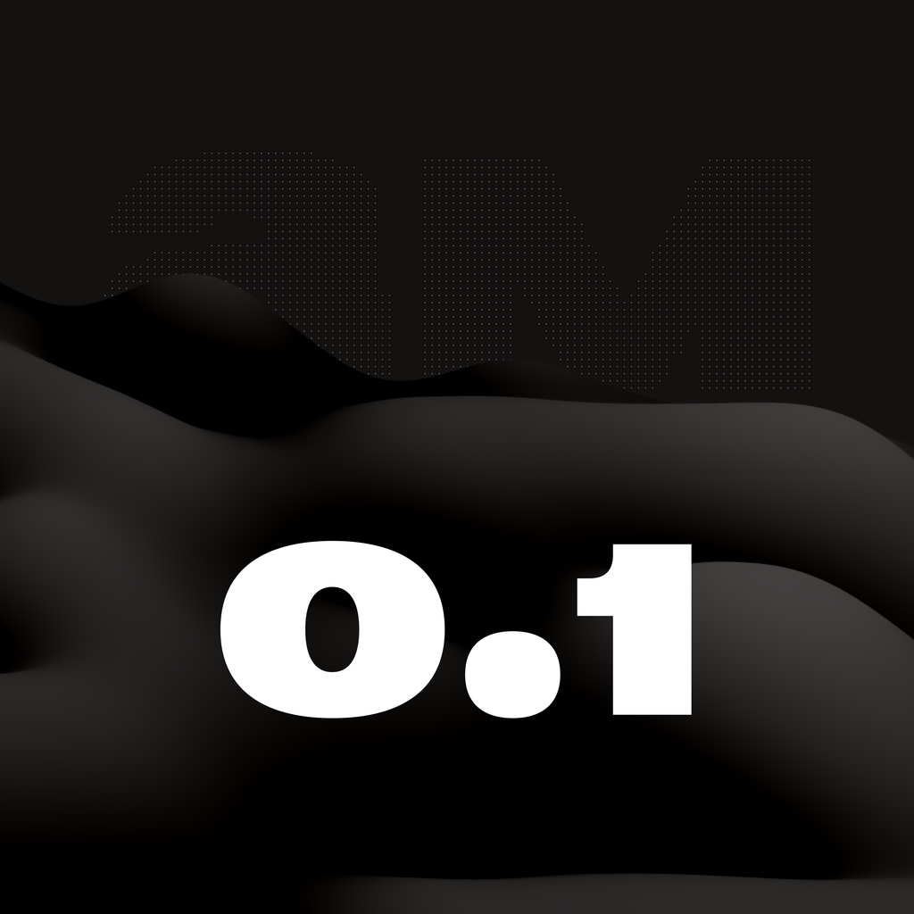
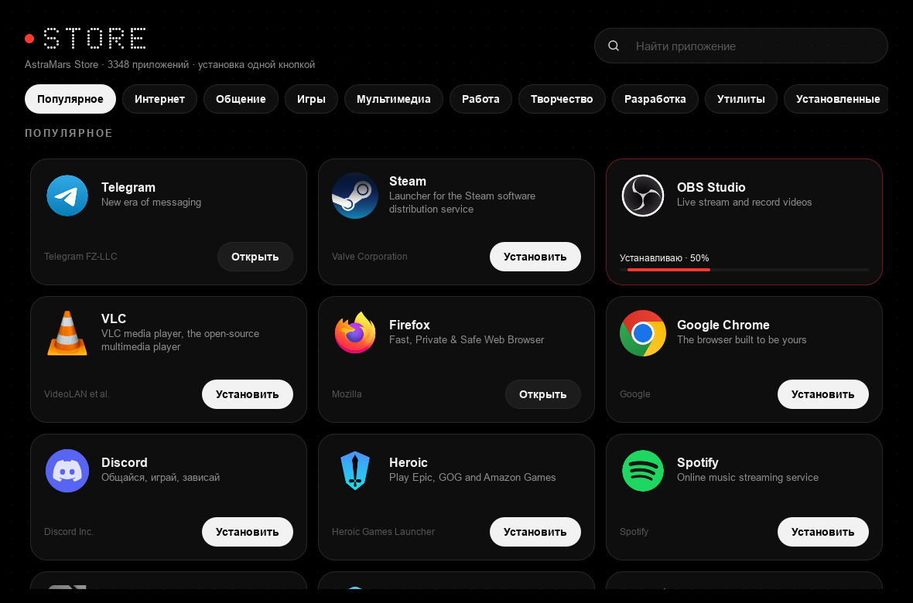
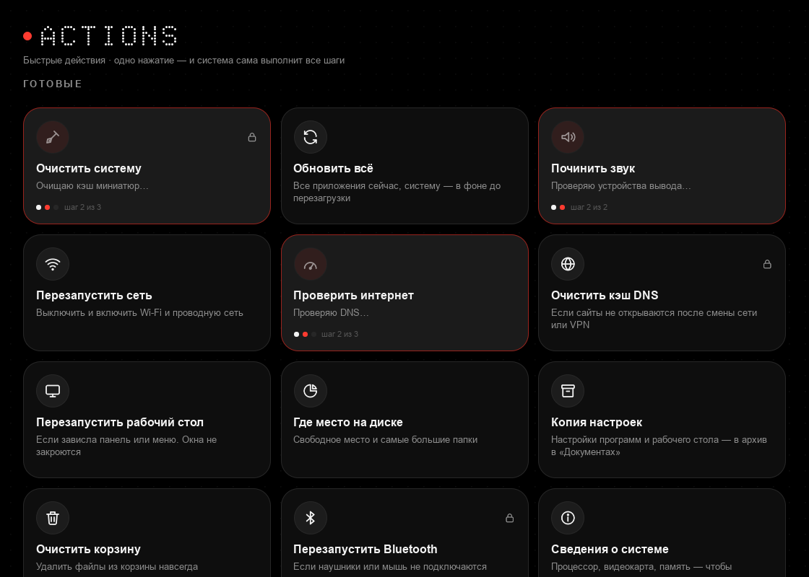
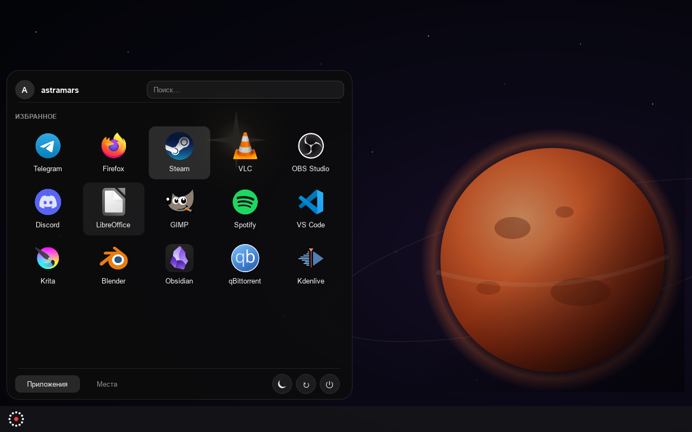
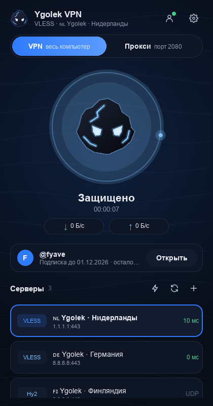

# AstraMars OS

Дистрибутив Linux на базе Fedora Kinoite (KDE Plasma 6), названный в честь кошки Астры и кота Марсика.
Тёмная тема, плавные анимации, атомарные обновления с откатом.

## Что внутри

| Путь | Что это |
|---|---|
| `Containerfile` | Описание системы: основа и шаги сборки |
| `build_files/build.sh` | Установка пакетов, тема, службы |
| `build_files/branding.sh` | Название системы (`/usr/lib/os-release`) |
| `system_files/` | Файлы, которые копируются в корень системы |
| `system_files/etc/xdg/kdeglobals` | Тёмная тема, шрифты, акцентный цвет |
| `system_files/etc/xdg/kwinrc` | Эффекты и анимации окон |
| `system_files/usr/share/wallpapers/AstraMars/` | Обои |
| `system_files/usr/share/pixmaps/astramars-logo.svg` | Логотип |
| `system_files/usr/share/astramars/flatpaks.list` | Программы, которые ставятся при первом запуске |
| `.github/workflows/build.yml` | Автосборка образа при каждом изменении |
| `.github/workflows/build-iso.yml` | Сборка установочного ISO (вручную) |

## Как запустить сборку

1. Создайте на GitHub **публичный** репозиторий `astramars-os`
   (для публичных репозиториев сборка и хранение бесплатны).
2. Загрузите туда эту папку (через GitHub Desktop или `git push`).
3. Откройте вкладку **Actions** и дождитесь зелёной галочки у «Сборка образа AstraMars OS» (15–25 минут).
4. Сделайте образ публичным: профиль GitHub → **Packages** → `astramars-os` →
   **Package settings** → **Change visibility** → **Public**.

Образ будет доступен как `ghcr.io/<ваш-логин>/astramars-os:latest` (логин маленькими буквами).

## Как поставить на свой ПК

**Вариант А — через Fedora Kinoite (рекомендуется для первого раза):**
1. Установите обычную Fedora Kinoite второй системой: https://fedoraproject.org/atomic-desktops/kinoite/
2. В терминале выполните:
   ```bash
   sudo bootc switch ghcr.io/<ваш-логин>/astramars-os:latest
   ```
   Если `bootc` ругается, то же самое делает:
   ```bash
   sudo rpm-ostree rebase ostree-unverified-registry:ghcr.io/<ваш-логин>/astramars-os:latest
   ```
3. Перезагрузитесь. Готово — дальше обновления приходят сами.

**Вариант Б — через свой ISO:**
Actions → «Сборка установочного ISO» → **Run workflow**. Когда закончится,
скачайте ISO внизу страницы запуска и запишите на флешку (Fedora Media Writer или Rufus).

## Экран входа и блокировки



Точечный стиль в духе матричных дисплеев и «стекло» как в iOS:
- обои из логотипа — точечные «AM» и чёрные дюны (`/usr/share/wallpapers/AstraMarsDots`);
- сверху дата с красной точкой, под ней крупное время круглыми точками (шрифт [Doto](https://fonts.google.com/specimen/Doto), OFL);
- поле пароля на полупрозрачной «стеклянной» подложке, круглые стеклянные кнопки сна, перезагрузки и выключения.

Экран входа — Plasma Login Manager. Он берёт часы, подложку и кнопки из QML-модуля
`org.kde.breeze.components`; наша копия модуля лежит в `/usr/share/astramars/login-theme/qml`
и подключается через `QML2_IMPORT_PATH`, системные файлы не меняются. Копия сделана для Plasma 6.8:
на другой версии сборка её не включает, и экран входа остаётся стандартным. При сборке модуль
загружается тестом (`build_files/login-theme.sh`), с ошибками образ не соберётся.

## Заставка загрузки

Своя тема Plymouth `astramars`: логотип в центре, под ним «ASTRAMARS OS» точками с красной точкой,
внизу кольцо из точек с бегущим огоньком — вместо логотипа и надписи Fedora. Картинки делает
`build_files/make_splash_assets.py` из `logo.png`; тема встраивается в initramfs при сборке,
и сборка проверяет, что она там есть (`build_files/plymouth.sh`).

## AstraMars Store



Магазин приложений: ищите в меню «AstraMars Store» или запустите `astramars-store`.
Подборка по разделам (Интернет, Общение, Игры, Мультимедиа, Работа, Творчество, Разработка, Утилиты),
поиск по всему Flathub (названия и описания по-русски), установка, запуск и удаление одной кнопкой.
На карточке видно, сколько процентов скачано и скорость.
Внутри — `flatpak` и Flathub: администраторы ставят без пароля, через прокси, если он включён.
**Обновления:** раздел «Обновления» — новая версия системы (кнопка «Обновить», затем «Перезагрузить»)
и обновления приложений; «Обновить всё» делает и то и другое. Система обновляется через `bootc upgrade`
в службах `astramars-update-check/apply.service` (`/usr/libexec/astramars-update`), которые администраторам
разрешено запускать без пароля; скачанная версия применяется после перезагрузки, откат — `sudo bootc rollback`.
При сборке `build_files/store_selftest.py` проверяет свежий каталог Flathub, а `astramars-store --check` — интерфейс.

## Быстрые действия



Плитки, по нажатию на которые выполняется цепочка шагов (`astramars-actions`, в меню — «Быстрые действия»):
очистить систему (с подсчётом освобождённого места), обновить всё, починить звук, перезапустить сеть,
проверить интернет (задержка, DNS, скорость), очистить кэш DNS, перезапустить рабочий стол, где место на диске,
копия настроек, очистить корзину (с подтверждением), перезапустить Bluetooth, сведения о системе.
Видно текущий шаг, итог и журнал. Свои действия: название и команды по одной в строке, можно от администратора
(через `pkexec`). Шаги, которым нужны права администратора, помечены замком.

## Меню приложений



Стиль Plasma «AstraMars» (`/usr/share/plasma/desktoptheme/astramars`): меню и всплывающие окна — чёрное стекло
с размытием, скругления 22 px, тонкая светлая рамка, мягкая подсветка пунктов; основа — Breeze Dark.
SVG генерирует `build_files/make_plasma_theme.py`. Меню (Kickoff): избранное и приложения сеткой, кнопки питания
значками, кнопка меню — точечное кольцо с красной точкой. Для каждого пользователя это один раз применяет
`/usr/libexec/astramars-menu-setup` при входе (через `evaluateScript` Plasma); стиль меняется, только если
пользователь не выбирал свой.

## Ygolek VPN



Встроенный VPN-клиент сервиса [Ygolek VPN](https://ygolek-vpn.online) на ядре
[sing-box](https://github.com/SagerNet/sing-box) 1.14.4 (раньше назывался AstraMars VPN).
Ищите в меню «Ygolek VPN» или запустите `ygolek-vpn`.

- **Аккаунт Ygolek:** «Войти» → QR-код или кнопка «Открыть Telegram» → «✅ Войти» в боте.
  Подписка добавляется сама, видно срок и лимит устройств, «Продлить» ведёт в бота.

- **Протоколы:** VLESS (Reality, Vision, WS, gRPC, HTTPUpgrade), VMess, Trojan,
  Shadowsocks (включая 2022 и obfs), Hysteria2 (с прыжками по портам), TUIC, AnyTLS, SOCKS5.
- **Подписки:** адрес `https://…` (или `happ://add/…`, `sing-box://…`, `v2rayng://…`) в любом формате:
  список ссылок, base64, sing-box JSON или Clash/Mihomo YAML;
  показывает остаток трафика и срок действия.
- **Два режима:** VPN (TUN, весь компьютер) и прокси `127.0.0.1:2080`.
  Режим VPN работает без пароля: ядро запускается системной службой `astramars-vpn@ИМЯ.service`
  с правами только на сеть, а правило polkit разрешает её администраторам.
- **Российские сайты напрямую** (Госуслуги, банки, `.ru`): включено по умолчанию.
- Пинг серверов, скорость в реальном времени, значок в трее, автозапуск.

Не поддерживаются: транспорт XHTTP (он есть только в ядре Xray), WireGuard из подписок
и зашифрованные подписки Happ.

Сборка образа проверяет клиент: `build_files/vpn_selftest.py` разбирает ссылки всех протоколов
и прогоняет каждую конфигурацию через `sing-box check`, а `ygolek-vpn --check` загружает интерфейс.

## Прокси (Happ и другие)

Если VPN-программа работает только в режиме прокси, AstraMars находит его сама:
раз в 30 секунд проверяет порты `10809 10808 2080 2081 7890 7897 1080 8080 20171 20172 8888`
и, если через прокси открывается интернет, направляет через него обновления системы,
Flatpak, Discover, терминал и рабочий стол KDE. Выключили прокси — всё идёт напрямую.

```bash
astramars-proxy            # состояние
astramars-proxy on 12345   # всегда использовать прокси на порту 12345
astramars-proxy auto       # снова автоматически
astramars-proxy off        # не использовать прокси
```

Браузер и программы рабочего стола подхватывают прокси после выхода и входа в систему.

## Откат

Если новая версия сломалась — при загрузке выберите в меню предыдущий пункт.
Или: `sudo bootc rollback` и перезагрузка.

## Перед публикацией для других людей

Fedora разрешает ремиксы, но запрещает выдавать их за официальную Fedora.
Перед публичным распространением нужно заменить логотипы Fedora (`fedora-logos`)
на свои — это следующий шаг проекта.
